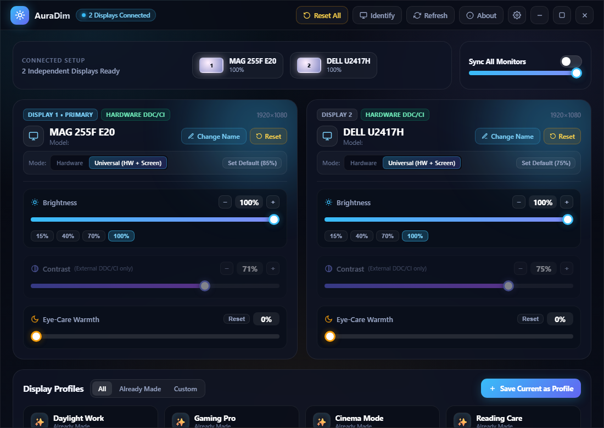
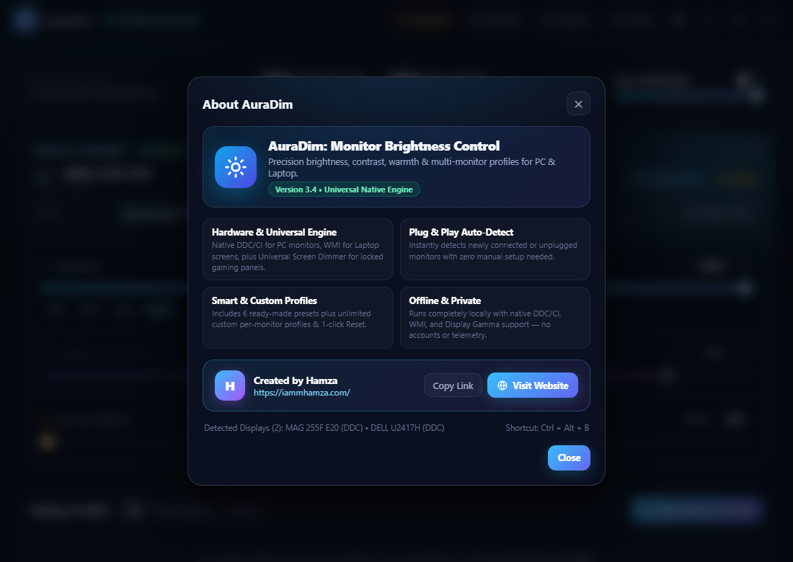
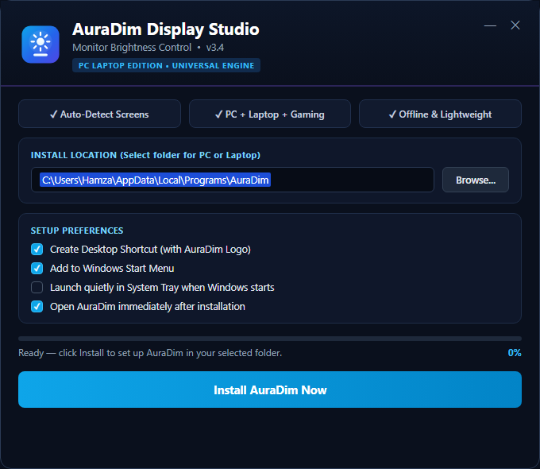

<div align="center">


# AuraDim — Monitor Brightness Control

**Precision brightness, contrast, color warmth & smart multi-monitor profiles for Windows PCs and Laptops.**

[](https://github.com/ihamxaafzal/AuraDim/releases/latest)
[](https://github.com/ihamxaafzal/AuraDim/releases/latest)
[](#-universal-3-layer-display-engine)
[](LICENSE)

[**Download Installer (`AuraDimSetup.exe v3.4`)**](https://github.com/ihamxaafzal/AuraDim/releases/latest) &bull; [**Features**](#-key-features) &bull; [**Screenshots**](#-ui-gallery) &bull; [**Build from Source**](#-build-from-source) &bull; [**Website**](https://iammhamza.com/)

</div>

---

## Why AuraDim?

Controlling brightness and contrast across mixed setups—such as a **laptop screen**, a **Dell office monitor**, and an **MSI MAG gaming monitor**—often fails when monitors block hardware DDC/CI commands, lock contrast in preset modes, or fluctuate on refresh.

**AuraDim v3.4** solves this with a zero-bloat native Windows engine (`.NET` + `WebView2`) that automatically detects every display plugged into your system and adapts seamlessly across all hardware types.

---

## Key Features

- **Automatic Plug & Play Detection:** Instantly discovers newly connected or unplugged monitors (HDMI, DisplayPort, USB-C, Thunderbolt, and internal eDP/LVDS laptop displays) with EDID model names.
- **Universal 3-Layer Display Engine:**
  - **Hardware DDC/CI (`VCP 0x10 / 0x13 / 0x12`)** with I2C bus pacing & multi-handle probing for desktop monitors.
  - **Native WMI Brightness (`WmiMonitorBrightness`)** with level snapping for built-in laptop panels.
  - **Universal Hybrid Mode (`Gamma LUT + Dimming Overlay`)** for gaming monitors, KVM switches, locked presets, or displays without DDC/CI support.
- **Independent or Synced Multi-Monitor Control:** Tune Brightness, Contrast, and Eye-Care Warmth separately per screen—or toggle **Sync All Monitors** to adjust every display together.
- **Top-of-Card Display Renaming:** Click **Change Name** (or double-click a display title) to label monitors cleanly (e.g., *Main Gaming*, *Side Vertical*, *Laptop*).
- **1-Click Reset & Custom Defaults:** Pin your preferred baseline with **Set Default**, then restore individual screens with **Reset** or all screens at once with **Reset All**.
- **Built-in & Custom Profiles:** Includes **6 ready-made profiles** (*Daylight Work*, *Gaming Pro*, *Cinema Mode*, *Reading Care*, *Midnight Low*, *Dual Setup Work*) plus unlimited custom per-monitor profiles.
- **Rock-Solid Refresh Stability:** Synchronized bus locking, pending-write flushing, and multi-read consensus verification prevent erratic DDC/CI readback jitter (`71 / 75 / 78`) on Refresh.
- **Responsive Across Every Display & DPI:** Adaptive layout with Per-Monitor DPI v2 support, Maximize/Restore, and 8-way window edge resizing works cleanly from compact laptops to 4K & ultrawide monitors.
- **Lightweight & Offline:** Runs locally with native Windows display interfaces (`DDC/CI`, `WMI`, `Gamma LUT`)—no external drivers and no background telemetry. Press `Ctrl + Alt + B` anytime to toggle AuraDim.

---

## UI Gallery

| Main Studio Dashboard | About & Engine Info |
| :---: | :---: |
|  |  |

<div align="center">
  
  <br />
  <sub>Standalone <b>AuraDimSetup.exe v3.4</b> installer with custom folder selection, logo icon embedding, and silent deployment flags.</sub>
</div>

---

## Installation

### Standard Setup (Recommended)
1. Download **`AuraDimSetup.exe`** from the [**Latest Release (v3.4)**](https://github.com/ihamxaafzal/AuraDim/releases/latest).
2. Run **`AuraDimSetup.exe`**, choose your install folder (defaults to `%LocalAppData%\Programs\AuraDim`), and click **Install AuraDim Now**.

### Silent / Automated Install (Microsoft Store & Enterprise)
```powershell
AuraDimSetup.exe --silent
# or
AuraDimSetup.exe /S
```

---

## Universal 3-Layer Display Engine

| Display Type | Detection Method | Brightness Control | Contrast & Warmth |
| :--- | :--- | :--- | :--- |
| **Built-in Laptop Panel** | WMI + `WmiMonitorConnectionParams` | Native WMI Backlight (`Levels[]` snapped) | Per-monitor Gamma Ramp + Warmth |
| **Desktop Monitor (DDC/CI)** | `EnumDisplayMonitors` + Multi-Handle Probe | Serialized `SetMonitorBrightness` / VCP `0x10`/`0x13` | Native DDC/CI + Universal Fallback |
| **Locked / Gaming / Docked Screen** | Automatic EDID + Mode Fallback | Universal Click-Through Overlay Dimming | Smooth `0.50x–1.65x` Gamma LUT + Amber Filter |

---

## Build from Source

Requires Windows 10/11 with built-in `.NET Framework 4.x` (`csc.exe`) and WebView2 Runtime (already pre-installed on Windows 11 and modern Windows 10):

```powershell
# Optional: regenerate multi-resolution application icon
powershell -ExecutionPolicy Bypass -File .\make_icon.ps1

# Compile AuraDim.exe and package AuraDimSetup.exe
powershell -ExecutionPolicy Bypass -File .\build.ps1

# Package x64 Microsoft Store MSIX
powershell -ExecutionPolicy Bypass -File .\build_msix.ps1
```

---

## Changelog — v3.4

- Rebranded app and Microsoft Store identity to **AuraDim: Monitor Brightness Control** (`iBlueApps.AuraDim`), with automatic one-time migration of existing user settings.
- Fixed fullscreen/maximized window close bug that could leave a black screen before minimizing cleanly to the system tray.
- Fixed Windows Settings / Control Panel uninstall command to cleanly remove the install folder, Start Menu/Desktop shortcuts, startup Run entry, and Uninstall registry key.

---

<div align="center">

Crafted with precision by **Hamza** &bull; [https://iammhamza.com/](https://iammhamza.com/)

</div>
